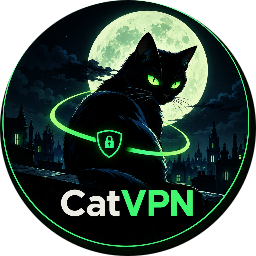
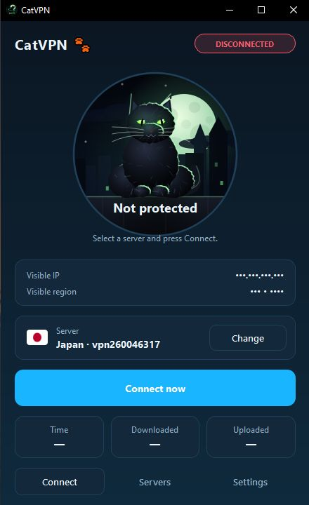
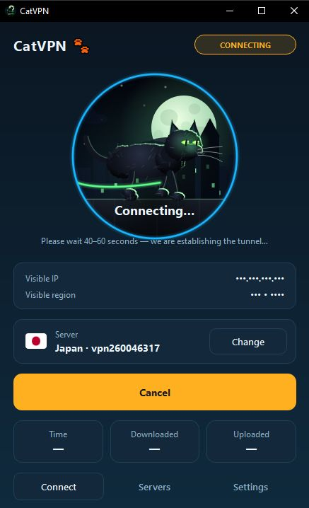
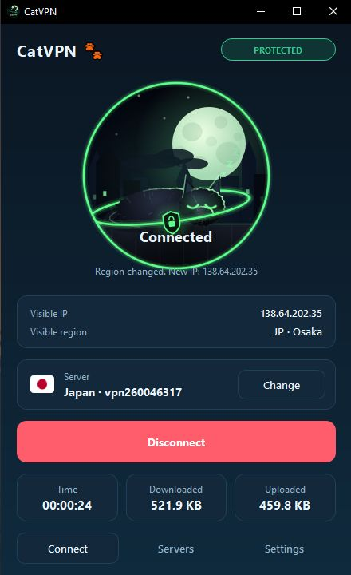
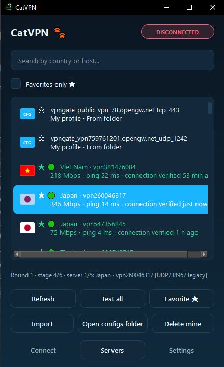
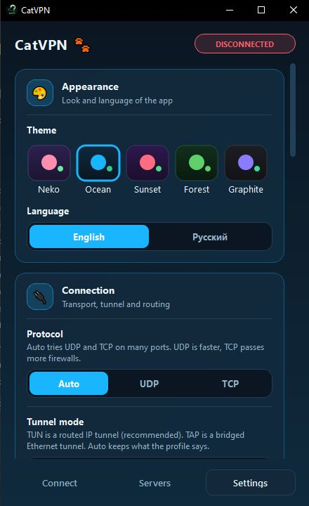

<div align="center">



# 🐾 CatVPN

### Free VPN client with a black cat that never gives up.

**OpenVPN · VPN Gate · Custom profiles · Shadowsocks · "Never give up" engine**

[](https://www.python.org/)
[](https://pypi.org/project/PyQt6/)
[](#-installation)
[](LICENSE)
[](https://github.com/YOUR_USERNAME/CatVPN/stargazers)
[](https://github.com/YOUR_USERNAME/CatVPN/network/members)

<br/>


<br/>

<a href="#-features"></a>
<a href="#-installation"></a>
<a href="#-screenshots"></a>
<a href="#-faq"></a>

</div>

---

<div align="center">

## ✨ What is CatVPN?

</div>

**CatVPN** is a desktop VPN client that brings together the best free public VPN servers from **VPN Gate** and your **own OpenVPN profiles** into one friendly app. It is powered by a **"never give up" connection engine**: it walks through every server, protocol, port and compatibility mode in rounds until something connects — or you press *Cancel*.

And yes — there is a **black cat** living in the connect button. 🐈‍⬛

- 🌙 At night she sits on a moonlit rooftop, tail swaying, eyes glowing.
- 🚶 While you connect, she walks along the ledge and the city scrolls past.
- 🛡 When the tunnel is up, a glowing green shield closes around her.
- 🍜 At meal times (7–9, 13–15, 19–21) she eats from a bowl with little sparkles.
- 💤 The rest of the day she sleeps and puffs "z" clouds into the air.

<div align="center">

**The cat reflects the real state of your connection — idle, connecting or protected.**

</div>

---

<div align="center">

## 📸 Screenshots

</div>

> 💡 *Add your own screenshots below. Drop them into `docs/` and replace the paths.*

<div align="center">

| Home — idle | Connecting | Protected |
|:---:|:---:|:---:|
|  |  |  |

| Servers list | Settings |
|:---:|:---:|
|  |  |

</div>

---

<div align="center">

## ✨ Features

</div>

<table>
<tr>
<td width="50%" valign="top">

### 🎯 Connection engine
- 🔁 **Never give up** — rounds of servers × protocols × ports until connected
- 🌐 **Auto / UDP / TCP** protocol selection
- 🔌 **Auto / TUN / TAP** tunnel mode
- 🧩 **Compatibility mode** for old servers (legacy ciphers, TLS 1.0)
- 🛰 **HTTP / SOCKS proxy** for TCP attempts
- ⏱ Configurable attempt timeout and TCP probe timeout
- 🔄 **Auto-reconnect** when the tunnel drops
- ✅ **Real handshake test** for every server (green = really works)

</td>
<td width="50%" valign="top">

### 🐱 The cat
- 🌙 Night/day sky — follows your real system time
- 🏙 Parallax city skyline with flickering windows
- 🐾 Hand-drawn fur, rim light from the moon, blinking eyes
- 🍜 Eats at meal times, sleeps the rest of the day
- 🛡 Green shield ring when the tunnel is up
- 🎨 5 themes: **Neko · Ocean · Sunset · Forest · Graphite**

</td>
</tr>
<tr>
<td width="50%" valign="top">

### 📂 Profiles
- 📥 Import `.ovpn`, `.conf`, `.cfg`, `.txt`, `.ini`, `.zip`
- 🗂 Drop files into `servers/configs` — loaded automatically
- 🔗 Paste OpenVPN text or **Shadowsocks `ss://` links**
- 📁 Certificates & keys next to a config are used automatically
- 🗑 Delete your own profiles from the app
- 🌍 Public VPN Gate servers with country flags

</td>
<td width="50%" valign="top">

### 🛡 Security & UX
- 🚫 `--block-outside-dns` on Windows (DNS leak protection)
- 🔍 External IP verification after connecting
- 🎭 **Real IP is hidden** — only the changed (VPN) IP is shown
- ⚠ Security warning before connecting to free servers
- 🖥 **System SOCKS proxy** support (Windows / macOS / GNOME) for Shadowsocks
- 🌐 **English & Русский** interface

</td>
</tr>
</table>

---

<div align="center">

## 🚀 Installation

</div>

### 1️⃣ Install OpenVPN

CatVPN is a **front-end** for OpenVPN — the actual tunnel is created by it.

| Platform | Command / Link |
|---|---|
| 🪟 **Windows** | [Download OpenVPN](https://openvpn.net/community-downloads/) — install as administrator, keep the TAP/Wintun drivers enabled |
| 🐧 **Linux** | `sudo apt install openvpn` · `sudo dnf install openvpn` · `sudo pacman -S openvpn` |
| 🍎 **macOS** | `brew install openvpn` |

### 2️⃣ Install Python dependencies

```bash
pip install PyQt6 psutil
```

### 3️⃣ Run CatVPN

> ⚠️ **Administrator / root rights are required** to create the tunnel.
> On Windows the app relaunches itself with elevated rights automatically.

<div align="center">

## 📂 Where do profiles go?

</div>

Drop **any** OpenVPN config into the folder below — regardless of extension. The app picks it up on the next refresh.

```text
CatVPN/
├── CatVPN.py
├── icons/
│   └── catvpn.png
└── servers/
    └── configs/          ← put your .ovpn / .conf / .cfg / .txt / .zip here
        ├── my-server.ovpn
        ├── ca.crt        ← certificates & keys next to the config
        ├── client.crt
        └── client.key
```

Imported profiles are also copied into `~/.cat_vpn/profiles/` (hidden folder in your home directory).

---

<div align="center">

## 🌍 How the "never give up" engine works

</div>

```text
┌─────────────────────────────────────────────────────────────┐
│  Round 1                                                    │
│  ┌───────────────────────────────────────────────────────┐  │
│  │ Server 1  →  udp/1194  →  tcp/443  →  udp/53  →  …    │  │
│  │ Server 2  →  udp/1194  →  tcp/443  →  udp/53  →  …    │  │
│  │ Server 3  →  udp/1194  →  tcp/443  →  udp/53  →  …    │  │
│  └───────────────────────────────────────────────────────┘  │
│                          ↓                                  │
│  Refresh server list  →  Round 2  →  Round 3  →  …          │
│                          ↓                                  │
│                ✅ Connected   /   ⛔ Cancelled               │
└─────────────────────────────────────────────────────────────┘
```

**For every attempt** the engine tries:

1. 🥇 The saved **"recipe"** that worked for this server before
2. 🎯 The **native** protocol and port from the profile
3. 🔀 The **alternative** protocol (UDP ⇄ TCP) on port 443
4. 🧓 **Legacy compatibility** mode (old ciphers, TLS 1.0)
5. 🔢 A list of **common alternative ports** (TCP: 443, 995, 992, 5555, 8443, 80 · UDP: 1194, 1195, 443, 53)

Every **real OpenVPN handshake test** (the *Test all* button) remembers the winning recipe — next time the server connects much faster.

---

<div align="center">

## 🎨 Themes

</div>

<div align="center">

| 🐾 Neko | 🌊 Ocean | 🌇 Sunset | 🌲 Forest | ⚫ Graphite |
|:---:|:---:|:---:|:---:|:---:|
| `#ff8fb1` | `#19b5fe` | `#ff6b81` | `#5fd068` | `#8b7bff` |

**Settings → Appearance → Theme**

</div>

---

<div align="center">

## 🔗 Shadowsocks support

</div>

CatVPN understands `ss://` links (SIP002 and the legacy base64 form) — paste them into the **Paste config / link…** dialog or drop them into a text file.

> ⚠ Shadowsocks works as a **SOCKS5 proxy**, not as a full VPN. Only apps that use the system proxy are tunneled.
> You need a Shadowsocks client next to CatVPN:
>
> - **Windows / macOS / Linux**: [`sslocal` (shadowsocks-rust)](https://github.com/shadowsocks/shadowsocks-rust/releases) — place it in the app folder or `bin/`
> - **Linux**: `sudo apt install shadowsocks-libev` (provides `ss-local`, needed for the legacy `rc4-md5` cipher)

When a Shadowsocks profile connects, CatVPN starts the client, sets the system SOCKS proxy, verifies the new IP, and **restores your original proxy settings on disconnect** — even if the app crashed (state is kept on disk).

---

<div align="center">

## ❓ FAQ

</div>

<details>
<summary><b>🔴 The connection never succeeds. What can I do?</b></summary>

<br/>

Public VPN Gate servers are heavily overloaded and often blocked by ISPs. Try:

1. Open **Servers** and press **Test all** — it really connects to every server and marks the working ones 🟢
2. Add working servers to **Favorites** (⭐) so they survive the refresh
3. Try a different **protocol** in Settings (UDP ⇄ TCP)
4. Set a **custom port** like `443` or `53` — these pass through more firewalls
5. If nothing works, your ISP is probably blocking OpenVPN entirely — use your **own profile** or a **Shadowsocks** link

</details>

<details>
<summary><b>🟢 "Test all" says green, but Connect fails. Why?</b></summary>

<br/>

Green only means the **TCP port answered** or the **OpenVPN handshake succeeded** *at that moment*. Servers can go offline seconds later, or drop the handshake due to server-side limits. The **Favorites** and **recipe** mechanisms make reconnecting much more reliable.

</details>

<details>
<summary><b>🛡 Does CatVPN hide my real IP?</b></summary>

<br/>

CatVPN shows **only the changed (VPN) IP** — the real one is masked as `•••.•••.•••.•••` and never displayed. However, on a **free public VPN server** your traffic passes through a third party. Treat the connection as **untrusted**:

- ✅ Use HTTPS sites only
- 🚫 Never enter passwords, card details or passport data
- 🕵 Assume the server could log your traffic

</details>

<details>
<summary><b>🪟 On Windows it asks for admin rights. Can I avoid that?</b></summary>

<br/>

No — creating a VPN tunnel modifies the routing table and network interfaces, which requires **administrator rights** on every OS. CatVPN relaunches itself elevated via the UAC prompt.

</details>

<details>
<summary><b>🐧 On Linux, sudo asks for a password and the GUI doesn't start.</b></summary>

<br/>

`sudo` sometimes loses the `$DISPLAY` variable. Use:

```bash
sudo -E python3 CatVPN.py
```

or add your user to the `sudoers` list with `NOPASSWD` for `openvpn` only (safer).

</details>

<details>
<summary><b>📦 How do I build a standalone .exe?</b></summary>

<br/>

With **PyInstaller**:

```bash
pip install pyinstaller
pyinstaller --noconfirm --windowed --onefile \
  --name CatVPN \
  --icon icons/catvpn.ico \
  --add-data "icons;icons" \
  CatVPN.py
```

The resulting `dist/CatVPN.exe` reads profiles from `servers/configs` next to the `.exe`.

</details>

<details>
<summary><b>🕵 Which servers does CatVPN use by default?</b></summary>

<br/>

The public list from **VPN Gate** (a research project of the University of Tsukuba, Japan). It provides ~15 servers per country, sorted by score. All of them are **volunteer-operated** — no guarantees, no logs policy, no SLA.

</details>

---

<div align="center">

## 🛠 Tech stack

</div>

<div align="center">

| Layer | Technology |
|---|---|
| 🎨 GUI | **PyQt6** — custom-drawn widgets, no QML |
| 🖌 Drawing | `QPainter`, `QPainterPath`, `QLinearGradient`, `QRadialGradient` |
| 🧠 Engine | `subprocess` + `threading` + `concurrent.futures` |
| 🌐 Networking | `urllib`, `socket`, plain **SOCKS5** implementation (no external libs) |
| 🔐 Crypto | `cryptography` (optional) or pure-Python X25519 for WARP keys |
| 📊 Stats | `psutil` (optional — the app works without it) |

</div>

---

<div align="center">

## 🤝 Contributing

</div>

Pull requests are welcome! A few ideas:

- 🌍 More themes (Halloween? Christmas? Cyberpunk?)
- 🐈 More cat poses and animations
- 🌐 More languages (German, Spanish, Japanese…)
- 🚀 A WireGuard backend for the WARP generator
- 📊 A real-time traffic graph on the home page

<div align="center">

```bash
# fork → clone → branch → commit → push → pull request
git checkout -b feature/amazing-thing
git commit -m "Add amazing thing ✨"
git push origin feature/amazing-thing
```

</div>

---

<div align="center">

## ⚠ Disclaimer

</div>

> **CatVPN is provided as-is, for educational and personal use.**
>
> - Public VPN Gate servers are operated by **third parties**. They may log, throttle or block your traffic.
> - Free VPNs are **not** a substitute for a paid privacy service. Do not send sensitive data through them.
> - You are responsible for complying with your local laws and the terms of service of any network you use.
> - The authors of CatVPN take **no responsibility** for how you use this software.

---

<div align="center">

## 📜 License

</div>

<div align="center">

**MIT License** — do whatever you want, just keep the copyright notice.

See [LICENSE](LICENSE) for details.

</div>

---

<div align="center">

## 💖 Support

</div>

<div align="center">

If CatVPN helped you — give it a ⭐ on GitHub, it means the world to a small black cat.

<a href="https://github.com/YOUR_USERNAME/CatVPN/stargazers">
  
</a>

<br/><br/>


<br/><br/>

**Made with 💜 and a lot of coffee by [YOUR_USERNAME](https://github.com/YOUR_USERNAME)**

<br/>


</div>
